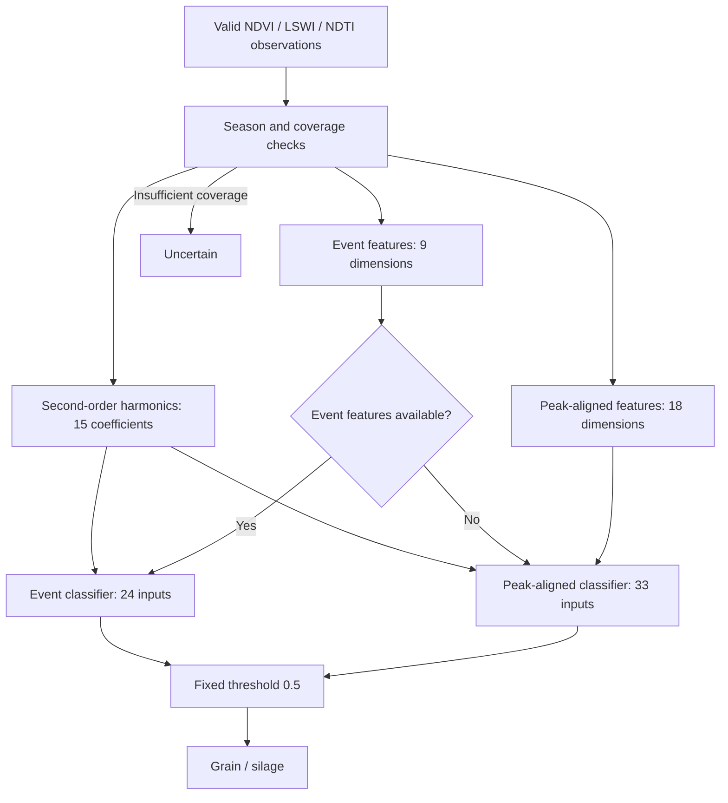

# CRUNCH

**Corn End-Use Recognition Using Normalized Indices, Change Points, and Harmonics**

**Authors: TIANYANG LIU and BORAN CUI** · Release **1.0.0** · Python **3.12** · CPU inference and training

CRUNCH distinguishes **grain corn** from **silage corn** using field-level NDVI, LSWI and NDTI time series. It combines the team's event-first, peak-aligned fallback architecture with second-order seasonal harmonics and two regularized logistic regression classifiers.

This repository includes the final trained model, raw index observations and labels for the fixed training/test split, source code, reproducibility checks, and comparisons with four published time-series methods.

## Quick start

```bash
python3.12 -m venv .venv
source .venv/bin/activate
python -m pip install -r requirements.txt
python verify.py
python evaluate.py
```

Evaluation writes `outputs/evaluation/predictions.csv` and `metrics.json`. After dependency installation, CRUNCH works offline without GPU, Slurm, satellite downloads or external accounts.

## Train and reproduce

```bash
# Reads data/train only. Preserves the released checkpoint.
OPENBLAS_NUM_THREADS=1 OMP_NUM_THREADS=1 python train.py
python evaluate.py --model outputs/crunch_retrained.joblib --output outputs/retrained_evaluation

# Verify hashes, split isolation, saved inference, and a fresh raw-data refit.
OPENBLAS_NUM_THREADS=1 OMP_NUM_THREADS=1 python verify.py --retrain
```

The release fixes harmonic order **2**, harmonic ridge **α = 0.01**, classifier **C = 0.3**, and decision threshold **0.5**. Training does not read the test set. No Dutch/NL data or NL-selected threshold is used by the released CRUNCH model.

## Data and results

| Split | Location / years | Field-years | Grain | Silage | Physical fields |
|---|---|---:|---:|---:|---:|
| Train | Yakima, Washington / 2015 | 599 | 37 | 562 | 599 |
| Test | BARC, Maryland / 2021–2023 | 44 | 32 | 12 | 34 |

| CRUNCH metric on MD | Value |
|---|---:|
| Accuracy | **95.45% (42/44)** |
| Macro-F1 | **0.939394** |
| Balanced accuracy | 0.916667 |
| Grain → silage errors | 0/32 |
| Silage → grain errors | 2/12 |

The train and test sets share no field-year IDs or physical fields. MD was excluded from fitting, but it was inspected repeatedly during historical development: this is a held-out-fitting benchmark, **not a previously unseen blind test**. Results apply to supported, full-season trajectories. See the [model card](docs/MODEL_CARD.md), [dataset documentation](docs/DATASET.md), and [published-method comparisons](docs/BENCHMARKS.md).

## Predict new fields

`fields.csv` requires `field_year_id,year`. `observations.csv` requires `field_year_id,date,ndvi,lswi,ndti`. Labels are not needed for inference.

```bash
python predict.py --fields data/test/fields.csv \
  --observations data/test/observations.csv --output outputs/predictions.csv
```

Use actual index values, such as `0.72`, and actual observation dates. CRUNCH uses May–November observations and reports `uncertain` for insufficient coverage. It outputs a silage score, route (`event` or `peak_aligned`) and class. A score ≥ 0.5 yields `silage`; a lower score yields `grain`. Scores are not externally calibrated probabilities. Only load trusted `joblib` files.

## Architecture



The branches are routed by observation support; they are not averaged or selected using test labels. Each contains mean imputation, weighted standardization, and L2 logistic regression. See [ARCHITECTURE.md](docs/ARCHITECTURE.md) for the exact event rules, feature ordering and harmonic objective.

## Repository layout

```text
models/crunch.joblib         Final CRUNCH checkpoint
data/train/                 599 labeled field-years and raw index observations
data/test/                  44 labeled field-years and raw index observations
train.py / predict.py        Training and raw-observation inference
evaluate.py / verify.py      Metrics, integrity checks and full refit validation
original_core.py             Team's dual-branch classifier and optical features
event_features.py           Candidate change-point feature extraction
docs/                       Architecture, model card, dataset and benchmarks
benchmarks/                 Published-method scripts and frozen reference results
reference/                  Frozen CRUNCH predictions, metrics and provenance hashes
CITATION.cff                 Citation metadata
LICENSE / DATA_LICENSE.md   MIT license and separate upstream data status
```

[中文说明](README_zh.md).
